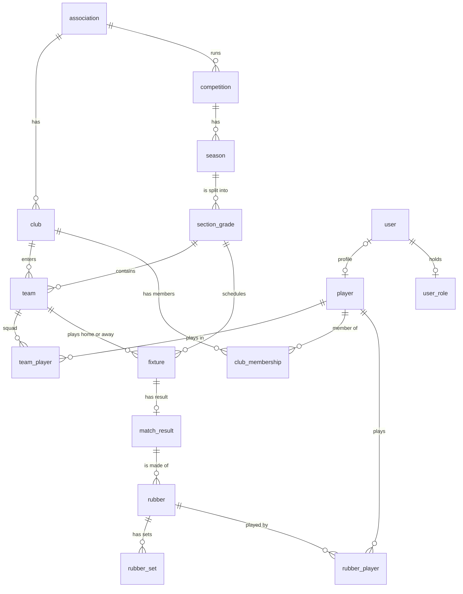

# TennisComp

Team management system for the Waverley Tennis Association. Players see their teams, fixtures,
results and standings; club administrators manage their club's players, teams and squads; the
association's administrator keeps an eye on its juniors.

| | Address |
| --- | --- |
| Live site | https://delightful-pond-03c981700.5.azurestaticapps.net |
| Live API (no page of its own) | https://tenniscomp-dkdxhgawdsbnfwgw.newzealandnorth-01.azurewebsites.net |
| Source code | https://github.com/melbMinhQuan/TennisCompPlatform |

> [!WARNING]
> The live site holds made-up test data only. Until real authentication is built, don't put real
> members' details into it. See [Known limitations and next steps](#known-limitations-and-next-steps).

---

## Handover at a glance

| Handover item | Where to find it |
| --- | --- |
| Codebase | This repository. `main` is the latest stable version, and the one running live: [Codebase and versions](#codebase-and-versions) |
| Licence | [LICENSE](LICENSE) transfers ownership to the Waverley Tennis Association; [third-party licences](#licence-and-third-party-software) |
| README and repository structure | [Repository structure](#repository-structure), with an index of every document |
| Database access | [Database access](#database-access): your computer and the live database |
| Hosting service access | [Hosting and deployment](#hosting-and-deployment): Azure, credentials, and moving it to your own account |
| Database structure (ERD) | [Database structure](#database-structure); every table and relationship in [docs/database.md](docs/database.md) |
| Data documentation | [Data and test accounts](#data-and-test-accounts) |
| Features, releases and changelog | [Features by sprint](#features-by-sprint), [Releases and tags](#releases-and-tags), [CHANGELOG.md](CHANGELOG.md) |
| AI use and security | [AI use and security](#ai-use-and-security) |
| What's not done yet | [Known limitations and next steps](#known-limitations-and-next-steps) |

---

## What the system does

| Who | Lands on | Can |
| --- | --- | --- |
| Player | Player pages | See their profile and UTR rating, competitions, upcoming fixtures, match history with scorecards, clubs and teams, ladders and rankings, and who to contact for help |
| Team manager | Player pages | All of the above, plus their team's details, including juniors' parent or guardian contacts |
| Club administrator | Club administration | See the club dashboard, fixtures and results, and notifications; register players and add them to the club; enter teams in a season; choose squads and team managers |
| Association administrator | Association administration | See every junior in the association, with an age check for each team they play in |

| Part | Built with | On your computer | Live |
| --- | --- | --- | --- |
| Frontend | React 19, React Router 7, Vite 6, Tailwind CSS 4, TypeScript | http://localhost:5173 | Azure Static Web Apps |
| Backend | NestJS 11 on Node.js 22, TypeScript | http://localhost:3000 | Azure App Service |
| Database | PostgreSQL, accessed through Prisma 5 | `localhost:5432` (PostgreSQL 16 in Docker) | Azure Database for PostgreSQL |
| Tests | Node's test runner, Vitest, Testing Library, Playwright | `npm test`, `npm run test:e2e` | GitHub Actions on every push |

---

## Features by sprint

The user stories each sprint delivered. [CHANGELOG.md](CHANGELOG.md) lists the branch and pull request
behind each one, and the User stories sheet of `docs/testing/TestingPlan-Sprint2.xlsx` maps each Sprint 2 story to
its tests.

**Sprint 1: Player (7 September – 4 October 2026), release `v1.0.0`**

| Story | As a player, I can | Status |
| --- | --- | --- |
| US-25 | Log in to my account | Done |
| US-26 | View my UTR rating | Done, from stored ratings; the live UTR connection is switched off |
| US-27 | View my profile | Done |
| US-28 | See all the clubs I belong to | Done |
| US-29 | View my match history | Done |
| US-30 | See my upcoming matches | Done |
| US-31 | Keep one central record across all my clubs | Done |
| US-32 | Represent different clubs in different competitions | Done |

**Sprint 2: Club Administration (5–25 October 2026), release `v2.0.0`**

| Story | As a club administrator, I can | Status |
| --- | --- | --- |
| US-18 | See and change only my own club | Done |
| US-19 | Search the player registry before creating a new player | Done |
| US-20 | Create a team in a season open for entries, with a name unique in that season | Done |
| US-21 | Add only active, eligible club members to a team's squad | Done |
| US-45 | Assign, change or remove a team manager | Done |
| Manage membership | Add a player to the club, bring back a former member, or end a membership | Partly: ending a membership waits on the client's decision (A07) |
| US-22 (Should) | Receive notifications about my club's fixtures | Partly: notifications in the app; no emails are sent |

Sprint 2 also delivered junior privacy rules, readable Player and Club IDs, and the association
administrator's juniors page.

**Not built yet:** entering, confirming, correcting and disputing results (US-37, US-39, US-23,
US-24), finals and emergency-player rules (US-35, US-38), club sign-up and association approval
(US-11, US-13), and draw generation. See [Known limitations and next steps](#known-limitations-and-next-steps).

---

## Codebase and versions

- Everything built during the semester is in this repository: frontend, backend, database
  migrations, test data, tests, CI/CD workflows and documentation.
- **`main` is the stable version** and the one running on the live site. Code only goes live after
  every automated check passes.
- `develop` collects finished work for the next release. Each piece of work starts on its own
  `feature/*` branch from `develop` and comes back through a pull request.
- To release, merge `develop` into `main` with a pull request; the live site then updates itself
  ([How releases work](#how-releases-work)).

### Releases and tags

Each sprint's release is tagged on `main`. [CHANGELOG.md](CHANGELOG.md) lists what each one contains.

| Tag | Release | Commit | Date |
| --- | --- | --- | --- |
| `v1.0.0` | Sprint 1: Player | `e7b8b0f` | 1 October 2026 |
| `v2.0.0` | Sprint 2: Club Administration | `6f9e556` | 24 October 2026 |

---

## Repository structure

```text
TennisComp/
├── frontend/
│   ├── api/                   # All backend calls (client.ts sends them) and the hooks that load them
│   ├── pages/                 # One file per route
│   ├── components/            # Page sections, grouped by page
│   ├── context/               # Who is signed in, shared by every page
│   ├── data/                  # Logged-out sample data and help content
│   ├── types/                 # Types used by several pages
│   ├── utils/                 # Date and formatting helpers
│   ├── tests/                 # Frontend tests (Vitest)
│   ├── resources/             # Images: the Waverley Tennis logo
│   ├── public/                # Copied into the build as is: Azure Static Web Apps routing
│   ├── src.tsx                # Entry point and routes
│   └── style.css              # Tailwind and the few styles it can't express
├── backend/
│   ├── prisma/                # Schema, migrations, test data workbook, seed and checks
│   ├── src/
│   │   ├── auth/              # Login
│   │   ├── dashboard/         # Profile dashboard and notifications
│   │   ├── player/            # /api/v1/player/* routes
│   │   ├── club-admin/        # /api/v1/club-admin/* routes
│   │   ├── association-admin/ # /api/v1/association-admin/* routes
│   │   ├── player-matching/   # Which player a scoresheet name means; profiles registered twice
│   │   ├── common/            # Shared DTO, guards and helpers (junior privacy, rubber winner)
│   │   ├── utr/               # UTR provider scaffold
│   │   └── prisma/            # Database client for NestJS
│   ├── test/                  # Backend tests
│   └── eslint.config.mjs      # Lint rules from the coding standards
├── e2e/                       # End-to-end tests (Playwright); live/ checks the deployed site
├── docs/
│   ├── deployment.md, database.md, junior-privacy.md, player-matching.md, hardcoded-values.md
│   ├── api/                   # API designs and contracts
│   ├── club-admin/            # One page per club administrator feature
│   ├── player-pages/          # One page per player page
│   ├── standards/             # coding_standards.docx and how the code compares with it
│   └── testing/               # TestingPlan.xlsx (every test) and the Sprint 2 testing plan
├── .github/                   # CI and deployment workflows, and the scripts they run
├── CHANGELOG.md               # What each release changed
├── LICENSE                    # Ownership and licence terms
├── playwright.config.ts       # End-to-end test settings (playwright.live.config.ts: live site)
└── docker-compose.yml         # Database container (PostgreSQL 16)
```

### Documentation index

| Document | What it covers |
| --- | --- |
| [docs/database.md](docs/database.md) | Every table and relationship (ERDs), and what data is in the database |
| [docs/deployment.md](docs/deployment.md) | Azure hosting: what runs where, settings, releases, the live database, troubleshooting, cost |
| [docs/junior-privacy.md](docs/junior-privacy.md) | Who may see a junior's details, and an account to try each view |
| [docs/player-matching.md](docs/player-matching.md) | Matching incomplete scoresheet names to players; finding profiles registered twice |
| [docs/hardcoded-values.md](docs/hardcoded-values.md) | What the frontend still hardcodes, and open product decisions |
| [docs/standards/](docs/standards/) | The team's coding standards (`coding_standards.docx`) and how the code compares with them (`coding-standards.md`) |
| [docs/club-admin/](docs/club-admin/) | The club administrator pages and their API routes: dashboard, edits (players, teams, squads, managers), fixtures, notifications, support |
| [docs/player-pages/](docs/player-pages/) | The player pages: what each shows and where its data comes from |
| [docs/api/](docs/api/) | API designs: the player dashboard API (`dashboardapi.md`, `dashboard-demo.md`), the login API (`authapi.md`, older: the response now also has the role, club and display name) and an early review of the data the dashboard needed (`dashboard-data-gaps.md`) |
| [docs/testing/](docs/testing/) | `TestingPlan.xlsx` (every test, checked by `npm run test:plan`) and the Sprint 2 testing plan with its user stories |
| [backend/src/utr/README.md](backend/src/utr/README.md) | Where a UTR connection plugs in |

---

## Hosting and deployment

### What runs where

| Part | Azure service | Name | Address |
| --- | --- | --- | --- |
| Frontend | Static Web Apps (Free) | `tenniscomp-web` | https://delightful-pond-03c981700.5.azurestaticapps.net |
| Backend | App Service, Linux, Node 22 (Free F1) | `tenniscomp` | https://tenniscomp-dkdxhgawdsbnfwgw.newzealandnorth-01.azurewebsites.net |
| Database | Database for PostgreSQL, Flexible Server (Burstable B1ms) | `tennis-db` | `tennis-db.postgres.database.azure.com:5432` |

All three are in an **Azure for Students** subscription that belongs to a team member and runs on
student credit. The frontend and database are in resource group `tenniscomp-rg`, the backend in
`tenniscomp_group`. [docs/deployment.md](docs/deployment.md) has every setting and the
troubleshooting guide.

### Access and credentials

This repository is public, so **no live password or key is written in it**. The team hands them
over privately (in person or through a password manager). Change each one once you have it.

| Access | Used for | How to get it |
| --- | --- | --- |
| [Azure portal](https://portal.azure.com) | Managing the three resources | The subscription's owner adds your own Microsoft account under **Access control (IAM) → Add role assignment → Owner**. Never use a team member's login. |
| Live database admin user and password | Connecting to `tennis-db` | Handed over privately. To change it: **tennis-db → Overview → Reset password**, then update `DATABASE_URL` in the backend's environment variables. |
| GitHub repository | The code, CI/CD and deployment secrets | Owned by `melbMinhQuan`. Transfer it to your account or organisation (**Settings → General → Transfer ownership**), or be added as an administrator. |
| Deployment secrets `AZURE_BACKEND_PUBLISH_PROFILE` and `AZURE_STATIC_WEB_APPS_API_TOKEN` | Letting GitHub Actions deploy to Azure | GitHub → **Settings → Secrets and variables → Actions**. New values come from Azure ([docs/deployment.md → Configuration](docs/deployment.md#configuration)). |
| Test accounts | Trying the site | [Test accounts](#test-accounts): made-up people, one shared password |

### Moving the hosting to the Association's Azure account

Azure for Students subscriptions can't be transferred to anyone else, and they stop when the
student's credit or eligibility runs out. To keep the site running, recreate it in an Azure
subscription the Association owns:

1. Create the same three resources: a Static Web App, a Linux App Service on Node 22 and a
   PostgreSQL Flexible Server. Putting all three in one region makes the site faster.
2. In the App Service, set `DATABASE_URL`, `CORS_ORIGIN` and `UTR_PROVIDER`, the startup command
   and SCM basic auth, as in [docs/deployment.md → Configuration](docs/deployment.md#configuration).
3. In GitHub, replace the two deployment secrets with the new publish profile and deployment token,
   and change `BACKEND_URL` and `FRONTEND_URL` at the top of both workflows in `.github/workflows/`
   (`deploy-backend.yml` and `deploy-frontend.yml`).
4. Re-run the latest CI run on `main`. The backend creates the tables when it starts.
5. Load data: the test data (`npm run seed:competition` against the new database), or real data
   ([docs/database.md → Starting with real data](docs/database.md#starting-with-real-data)). The
   check after each deploy logs in as Charlotte Reed and Margaret Hayes from the test data; keep
   them, or change `e2e/live/live-site.spec.ts`.
6. Once the new site works, delete the old resources.

### How releases work

CI runs on every push to any branch. A push to `main` also deploys, but only once every check has
passed: first the backend, then the frontend, then a browser logs in to the live site to check it.

- **Database changes** (Prisma migrations) are applied to the live database automatically when the
  backend restarts.
- **Test data is not.** After changing the workbook, run the seed against the live database
  ([docs/deployment.md → Database](docs/deployment.md#database)).
- **To redeploy**, open the latest CI run on `main` in the **Actions** tab and choose
  **Re-run all jobs**.

### Settings

| Variable | Where | Default | Purpose |
| --- | --- | --- | --- |
| `DATABASE_URL` | `backend/.env`; App Service environment variables | required | Database connection |
| `PORT` | `backend/.env` (App Service sets its own) | `3000` | API port |
| `CORS_ORIGIN` | `backend/.env`; App Service environment variables | `http://localhost:5173` | Frontend address(es) allowed to call the API, comma-separated |
| `UTR_PROVIDER` | `backend/.env`; App Service environment variables | `disabled` | `disabled`, `mock` or `engage` |
| `VITE_API_URL` | `frontend/.env`; set by `deploy-frontend.yml` for the live site | `http://localhost:3000` | Backend address the frontend calls |

Don't add `NODE_ENV=production` to the live backend: until real authentication exists, it switches
off every player and club administrator route.

**Cost.** Static Web Apps and App Service are on free plans. The database is the only paid part,
about US$15–25 a month once free allowances run out. Stop it from its **Overview** page when the
site isn't needed ([docs/deployment.md → Cost](docs/deployment.md#cost)).

---

## Database

### Database access

**On your computer** (Docker, after the [Quick start](#running-it-on-your-computer)):

| Setting | Value |
| --- | --- |
| Host and port | `localhost`, `5432` |
| Database | `tenniscomp` |
| User | `tenniscomp` |
| Password | `tenniscomp` |

- **In the browser:** `npm run prisma:studio --workspace=backend`, then open http://localhost:5555.
  It only works while that command is running.
- **Command line:** `docker exec -it tenniscomp-postgres psql -U tenniscomp -d tenniscomp`. Inside
  psql, `\dt` lists the tables, `SELECT * FROM "user" LIMIT 5;` shows rows and `\q` quits.
- **A database app** (DBeaver, TablePlus, pgAdmin): the settings above.

**Live (Azure):**

| Setting | Value |
| --- | --- |
| Host and port | `tennis-db.postgres.database.azure.com`, `5432` |
| Database | `postgres` |
| User and password | The server's admin login, handed over privately ([Access and credentials](#access-and-credentials)) |
| SSL | Required (`sslmode=require`) |

First allow your IP address in **tennis-db → Networking → Firewall rules** (**+ Add current client
IP address**). Then connect with a database app, or run commands such as the seed from a terminal:
[docs/deployment.md → Running a command against the live database](docs/deployment.md#running-a-command-against-the-live-database).

### Database structure

A relational PostgreSQL database with 33 tables, defined in
[backend/prisma/schema.prisma](backend/prisma/schema.prisma) and built by the migrations next to it.

| Area | Tables | What they hold |
| --- | --- | --- |
| Accounts and people | `user`, `user_role`, `player`, `utr_link`, `profile_merge_request`, `notification`, `audit_log` | Logins and their one role, player profiles (with juniors' guardians), notifications, change history |
| Associations, clubs and venues | `association`, `club`, `venue`, `club_membership`, `association_membership` | Who belongs where, and where matches are played |
| Competitions, seasons and teams | `competition`, `match_format`, `eligibility_rule`, `season`, `section_grade`, `team`, `team_player` | The competition structure, teams and squads |
| Fixtures and results | `fixture`, `fixture_schedule_change`, `match_result`, `result_confirmation`, `correction_request`, `rubber`, `rubber_set`, `rubber_player` | The draw, every score, and who played |
| Ladders, standings, ratings and awards | `ladder_entry`, `player_standing`, `utr_rating_snapshot`, `ranking_cohort`, `ranking_entry`, `player_award` | Ladders, standings, UTR ratings and rankings, titles |

How the main tables connect (entity relationship diagram):



An association has clubs and runs competitions. A competition has seasons, a season is split into
sections, and clubs enter teams into sections. A fixture is a match between two teams; its result
is made of rubbers (single singles or doubles matches), each with its sets and players. A user is a
login, which usually has a player profile and exactly one role.
[docs/database.md](docs/database.md) has one diagram per area, every table and its columns, and
which links the database enforces.

### Changing the database schema

After editing `backend/prisma/schema.prisma`, create a migration from the project root:

```bash
npm run prisma:migrate --workspace=backend -- --name describe_your_change
```

To apply migrations that came with new code, run in `backend/`:

```bash
npx prisma migrate deploy
npx prisma generate
```

The live database gets new migrations automatically on the next release. CI fails if
`schema.prisma` changes without a migration.

---

## Data and test accounts

### What's in the database

**Everything in both databases is made-up test data.** It all comes from one workbook,
[backend/prisma/competition_data.xlsx](backend/prisma/competition_data.xlsx): one sheet per table,
8,977 rows, covering two associations, twelve clubs, five competitions, 292 fixtures, 274 results,
ladders, standings, UTR ratings and notifications. The live database was filled from the same
workbook.

- Every email address uses a reserved `.example` domain, and phone numbers, dates of birth, ratings
  and addresses are invented. Only the competition rules and match formats come from a real
  source, the Waverley Tennis competition match formats document.
- 124 logins: 92 players, 18 team managers, 12 club administrators (one per club), one association
  administrator and one records secretary. Passwords are stored only as bcrypt hashes, which is
  why the workbook is safe to keep in the repository.
- Hiro Mitchell and Amelia Lee are each two different people, on purpose, to prove look-alikes
  never get mixed up. Tests keep it that way (DATA-001, TEAM-003, E2E-010).
- Ten juniors (under 18) play in Weekend Junior's coming season, each with a parent or guardian on
  record; two of the parents manage a team. Who may see what is in
  [docs/junior-privacy.md](docs/junior-privacy.md).
- Only the club administrator pages change data (teams, squads, managers, new players,
  memberships, notifications read). Fixtures, results, ladders and rankings come only from the
  workbook, because no page enters results yet.

[docs/database.md → Data in the database](docs/database.md#data-in-the-database) has the row count
of every table, the personal details the database can hold, and how to start with real data.

### Test accounts

All accounts share the password **`WaverleyDev#2026`**, on your computer and on the live site.

| Role | Email | What to try |
| --- | --- | --- |
| Player | `chloe.cooper005@players.example` | Profile, competitions, matches, clubs, standings, help |
| Player | `charlotte.reed004@players.example` | The live-site check after each deploy logs in as her, so keep her |
| Team manager | `yuki.green008@players.example` | Their team's details |
| Club administrator | `margaret.hayes@admin.example` | Glen Waverley's club pages; also used by the live-site check |
| Club administrator | `julie.prentice@admin.example` | Chadstone's club pages |
| Association administrator | `raj.mitchell001@players.example` | Every junior, with age checks |
| Junior | `leo.fitzgerald@juniors.example` | A junior's own view |
| Parent and team manager | `adaeze.okafor@families.example` | Glen Waverley 18U, with its juniors' parent contacts |

Every other address in the `User` sheet of the workbook works too.

### Changing the test data

Run these in `backend/`:

```bash
npm run seed:competition              # load the data: safe to re-run, only inserts what is missing
npm run seed:competition -- --dry-run # show what it would do, write nothing
npm run seed:competition -- --sync    # make the database match the workbook exactly
```

**Edit the generator, not the spreadsheet**, or the next regeneration loses your change:

```bash
npm run data:generate                 # rebuild competition_data.xlsx
npm run data:check                    # check it against the schema and the competition rules
npm run seed:competition -- --sync    # load it; --sync because codes may have shifted
```

`--sync` also deletes rows the workbook no longer has, including rows changed by hand, but never
login accounts it doesn't recognise. Scoresheets often record incomplete names ("Josh" for Joshua
Smith); how the system works out who is meant is in [docs/player-matching.md](docs/player-matching.md).

---

## Running it on your computer

All commands run from the project root (the folder with this README) unless a step says otherwise.

**1. Requirements, once per computer:** [Node.js](https://nodejs.org) 22 or newer (`node -v` to
check), and [Docker Desktop](https://www.docker.com/products/docker-desktop/), which must be running
whenever you use the app.

**2. First-time setup, once after cloning:**

```bash
npm install
cp backend/.env.example backend/.env
cp frontend/.env.example frontend/.env
docker compose up -d
cd backend
npx prisma generate
npx prisma migrate deploy
npm run seed:competition
cd ..
```

That installs the dependencies, creates the local settings files, starts PostgreSQL in Docker,
builds the database client, creates the tables and loads the test data. To change a Docker setting
only on your computer (such as the port), put it in a `docker-compose.override.yml`, which git
ignores.

**3. Start the app, every time,** in two terminals:

```bash
# Terminal 1: database and backend
docker compose up -d
npm run dev:backend
```

```bash
# Terminal 2: frontend
npm run dev:frontend
```

Open http://localhost:5173 and log in with a [test account](#test-accounts). `Ctrl+C` stops each
terminal; `docker compose down` stops the database and keeps its data.

### Commands

| Command (from the project root) | What it does |
| --- | --- |
| `npm run dev:backend` | Starts the backend on port 3000 |
| `npm run dev:frontend` | Starts the frontend on port 5173 |
| `npm run prisma:studio --workspace=backend` | Opens the database in the browser on port 5555 |
| `npm test` | Unit and integration tests (no database needed) |
| `npm run test:coverage --workspace=backend` (or `=frontend`) | The same tests with a coverage report; fails below the minimums |
| `npm run test:e2e` | End-to-end tests in Chrome (database running and seeded) |
| `npm run test:database --workspace=backend` | Tests on the real local database, rolled back afterwards |
| `npm run test:plan` | Checks `docs/testing/TestingPlan.xlsx` has a row for every test and a test for every row |
| `npm run lint --workspace=backend` | Checks the backend against the coding standards (`docs/standards/`) |
| `npm run data:check --workspace=backend` | Checks the test-data workbook against the schema and the competition rules |
| `npm run players:duplicates --workspace=backend` | Lists profiles that are probably one person registered twice |
| `docker compose down -v` | Stops the database and **deletes all its data** |

<details>
<summary><strong>Troubleshooting</strong></summary>

| Problem | Fix |
| --- | --- |
| `Cannot connect to the Docker daemon`, or the database won't start | Open Docker Desktop, wait until it's running, then `docker compose up -d` |
| `EADDRINUSE :::3000` | A backend is already running. Stop it: `lsof -ti:3000 \| xargs kill` |
| `Port 5173 is in use` | Another frontend is running. Stop it: `lsof -ti:5173 \| xargs kill`. The frontend must use 5173, because the backend only accepts requests from there |
| `relation "user" does not exist` | The tables are missing. Run `npx prisma migrate deploy` in `backend/` |
| Pages are empty after logging in | No test data. Run `npm run seed:competition` in `backend/` |
| `PLAYER_PROFILE_NOT_LINKED` | That login has no player profile. Use a `.example` test account |
| Logged out after refreshing | Expected for players for now: the login is kept only in page memory |
| http://localhost:5555 won't load | Prisma Studio isn't running: `npm run prisma:studio --workspace=backend` |
| Errors after pulling new code | Run `npm install`, then in `backend/`: `npx prisma migrate deploy` and `npx prisma generate` |

</details>

---

## Testing and CI

[TestingPlan.xlsx](docs/testing/TestingPlan.xlsx) lists every test: its ID, what it checks and how to run it.
Each test's name starts with its ID (such as `AUTH-002`), so a failure points straight to its row,
and `npm run test:plan` fails if a test and the plan disagree. For traceability, the User stories
sheet of `docs/testing/TestingPlan-Sprint2.xlsx` maps each Sprint 2 user story to the tests that cover it.

| Type | What it covers | Where | Run with |
| --- | --- | --- | --- |
| Unit | One function or service, with a fake database | `backend/test/`, `frontend/tests/` | `npm test` |
| Integration | A real HTTP route, or a rendered page or component | the same folders | `npm test` |
| Database | The seed, player matching and junior privacy on a real PostgreSQL, rolled back afterwards | `backend/test/*.integration.cjs` | `npm run test:database --workspace=backend` |
| End to end | The whole app in Chrome on the seeded database, as players and club administrators | `e2e/` | `npm run test:e2e` |
| Live | The deployed site in a browser, after each release | `e2e/live/` | CI only |

GitHub Actions ([.github/workflows/ci.yml](.github/workflows/ci.yml)) runs on every push:

- **test-and-build:** checks the workbook and the testing plan, lints the backend, runs the
  backend and frontend tests with coverage minimums, then type-checks and builds the frontend.
- **end-to-end:** builds a fresh database, fails if a schema change has no migration, runs the
  database tests, seeds it, then runs the end-to-end tests on the production build.
- **backend-package:** builds the backend exactly as Azure receives it and checks it starts.
- **deploy-backend, then deploy-frontend:** only on `main`, and only after all three pass.

A red ❌ on a pull request means something broke; open the run to see which test ID failed. For an
end-to-end failure, download the `playwright-report` attached to the run. Two end-to-end tests
change the database the way a club administrator would (E2E-017, E2E-018). They use new names on
every run, so they can run again and again; `npm run seed:competition -- --sync` clears them out.

---

## API

The player routes take `?email=` (the logged-in player's address) and answer `{ "data": ... }`.

| Route | Returns | Used by |
| --- | --- | --- |
| `POST /auth/login` | `login_success` with the account's `role`, `clubId`, `clubName` and `displayName`, or `login_failed` (both status 200) | Login |
| `GET /api/v1/player-dashboard` | Profile, UTR, career summary, 4 newest notifications | Profile |
| `GET /api/v1/player-dashboard/notifications` | All notifications and the unread count | Notifications → View All |
| `GET /api/v1/player/competitions` | One entry per active team, with its next fixture | Competitions |
| `GET /api/v1/player/fixtures` | All fixtures of the player's teams | Matches → Upcoming |
| `GET /api/v1/player/results` | The player's finalised rubbers, newest first | Matches → History, Recent Activity |
| `GET /api/v1/player/memberships` | Association and club memberships, teams, and the team the login manages | My Clubs |
| `GET /api/v1/player/teams/:teamId` | Team details and roster (own or managed teams only; juniors' parent contacts for the manager only) | Team Details |
| `GET /api/v1/player/standings` | Ladders, player standings, UTR rankings | Standings & Rankings |
| `GET /api/v1/player/support-contacts` | Team manager, club administrator, records secretary | Help & Support |

Errors: `400` for a bad email or team ID; `404` with `USER_NOT_FOUND`, `PLAYER_PROFILE_NOT_LINKED`
or `TEAM_NOT_FOUND`; `503 DATA_UNAVAILABLE` when the database can't be read.

- **Club administrators** use `/api/v1/club-admin/*`, also with `?email=`. The club always comes
  from the administrator's role, never from the request. The routes are described in the
  files in `docs/club-admin/`.
- **The association administrator** uses `GET /api/v1/association-admin/juniors?email=`: every
  junior, with an age check per team. Only an `ADMINISTRATOR` gets it.
- **A rubber's winner** is its recorded `winner_side` (after a retirement or walkover), otherwise
  whoever won more sets, then more games.

---

## Licence and third-party software

**Ownership.** Under [LICENSE](LICENSE), the team transfers all rights in this code, its
documentation, database schema and test data to the Waverley Tennis Association, which may then
use, change and share it freely. The Waverley Tennis name and logo belong to the Association.

**Third-party software.** No third-party source files are copied into this repository. Everything
else the system uses comes in as open-source npm packages, listed in the `package.json` files and
locked to exact versions in `package-lock.json`.

| Main packages | Used for | Licence |
| --- | --- | --- |
| React, React DOM, React Router | The frontend | MIT |
| Vite, Tailwind CSS | Building and styling the frontend | MIT |
| NestJS, class-validator, class-transformer | The backend and its input checks | MIT |
| Prisma | The database client and migrations | Apache-2.0 |
| bcryptjs | Password hashing | BSD-3-Clause |
| SheetJS (`xlsx`) | Reading and writing the test-data workbook | Apache-2.0 |
| TypeScript | The language of the frontend and backend | Apache-2.0 |
| Vitest, Testing Library, Playwright, ESLint | Tests and checks | MIT; Playwright is Apache-2.0 |

All 125 packages the live system runs are under MIT, Apache-2.0, ISC or BSD licences, which allow
commercial use, changes and redistribution as long as their copyright notices are kept. Tools
used only while building or testing add a few other licences: more permissive ones (BlueOak-1.0.0,
the Unlicense, MIT-0), Lightning CSS (MPL-2.0), caniuse-lite's browser data (CC-BY-4.0) and
argparse (Python-2.0). None of them is part of the live system.
`npx license-checker --summary` lists every package and its licence.

**Data and images.** The competition rules and match formats in the test data come from the
Waverley Tennis competition match formats document. The logo in `frontend/resources/Logo.png` is
the Association's.

---

## AI use and security

**Short version:** we used AI coding tools, mainly Claude Code, to boost productivity, while
keeping full technical understanding of and control over the project. AI drafted; we reviewed,
tested and decided.

Commits that AI helped write end with a `Co-Authored-By: Claude …` line. On 24 October 2026 that was
21 of the 116 commits on `develop`. To list them:

```bash
git log --grep="Co-Authored-By: Claude" --oneline
```

The security measures in place follow common advice for AI-assisted development (OWASP's
[Secure Coding with AI cheat sheet](https://cheatsheetseries.owasp.org/cheatsheets/Secure_Coding_with_AI_Cheat_Sheet.html),
OpenSSF's [guide for AI code assistants](https://best.openssf.org/Security-Focused-Guide-for-AI-Code-Assistant-Instructions.html)
and the Australian Cyber Security Centre's
[Engaging with AI](https://www.cyber.gov.au/business-government/secure-design/artificial-intelligence/engaging-with-artificial-intelligence)):

- **A person checks everything.** AI output is a draft until a team member has read and tested it,
  and AI-written commits are labelled, so they're easy to trace.
- **Every push gets checked.** CI type-checks all the code, lints the backend (no `any`, `===`
  only, no unused code) and runs the unit, integration, database and end-to-end tests with
  coverage minimums. It also fails if a database change has no migration, and makes sure the
  backend package starts before it can ship. The live site only updates from `main`, after all of
  that passes.
- **No secrets in the code.** Passwords, keys and connection strings live only in Azure and GitHub
  Secrets, and `.env` files are git-ignored. We checked the whole git history: none has ever been
  committed, so they never reach this public repository or the AI tools working in it.
- **No real personal data.** The test data is made up and every email uses a reserved `.example`
  domain, so AI tools never handled real members' details.
- **Safe defaults in the code.** Every input is validated and unknown fields are dropped. Passwords
  are stored only as bcrypt hashes and never sent back. Database errors come back as a plain 503
  that reveals nothing. A club administrator only ever reaches their own club, taken from their
  role, never from the request. Juniors' details are shown only to those who need them, with tests
  for each role.
- **Locked dependencies.** Exact versions are pinned in `package-lock.json`, and CI installs exactly
  those (`npm ci`).

These cover how the system was built. The app itself still needs real authentication before real
members use it; see below.

---

## Known limitations and next steps

Roughly most important first:

1. **No real authentication yet.** Logging in checks the password, but after that the API trusts
   the email address the page sends. So the live site must hold test data only. Next step: a
   session or token checked on every request ([docs/deployment.md → Security](docs/deployment.md#security)).
2. **Logins only come from the test-data workbook.** There's no sign-up, no password reset and no
   page for creating logins, and every test account shares one published password.
3. **Results can't be entered yet.** Fixtures, results, ladders, standings and rankings are
   read-only in the app and come from the test data.
4. **Login has no attempt limit, and the app connects to the database as its admin.** Add rate
   limiting, and a database user with only the rights the app needs.
5. **Hosting is on a student subscription.** Move it to the Association's own Azure account
   ([how](#moving-the-hosting-to-the-associations-azure-account)).
6. **Branch protection is off.** CI checks every push, but GitHub doesn't yet block a merge when a
   check fails. Turn it on for `main` and `develop` under **Settings → Branches**: require a pull
   request and passing checks.
7. **Dependency updates.** On 24 October 2026, `npm audit` reported five issues in packages the
   backend uses. `npm audit fix` fixes all but the SheetJS one, which has no npm fix; only the
   developers' data scripts use SheetJS, on the team's own workbook.
8. **Open product decisions,** and what the frontend still hardcodes, are listed in
   [docs/hardcoded-values.md](docs/hardcoded-values.md).
9. **The UTR connection is switched off** (`UTR_PROVIDER=disabled`). It's ready for the
   Association to connect ([backend/src/utr/README.md](backend/src/utr/README.md)).
10. **Coding-standards follow-ups** are in [docs/standards/coding-standards.md](docs/standards/coding-standards.md).

---

Built by the TennisComp team (GitHub: melbMinhQuan, Ejalyna, Xt162, Merryleang and zhe3364) for the
Waverley Tennis Association, 2026.
