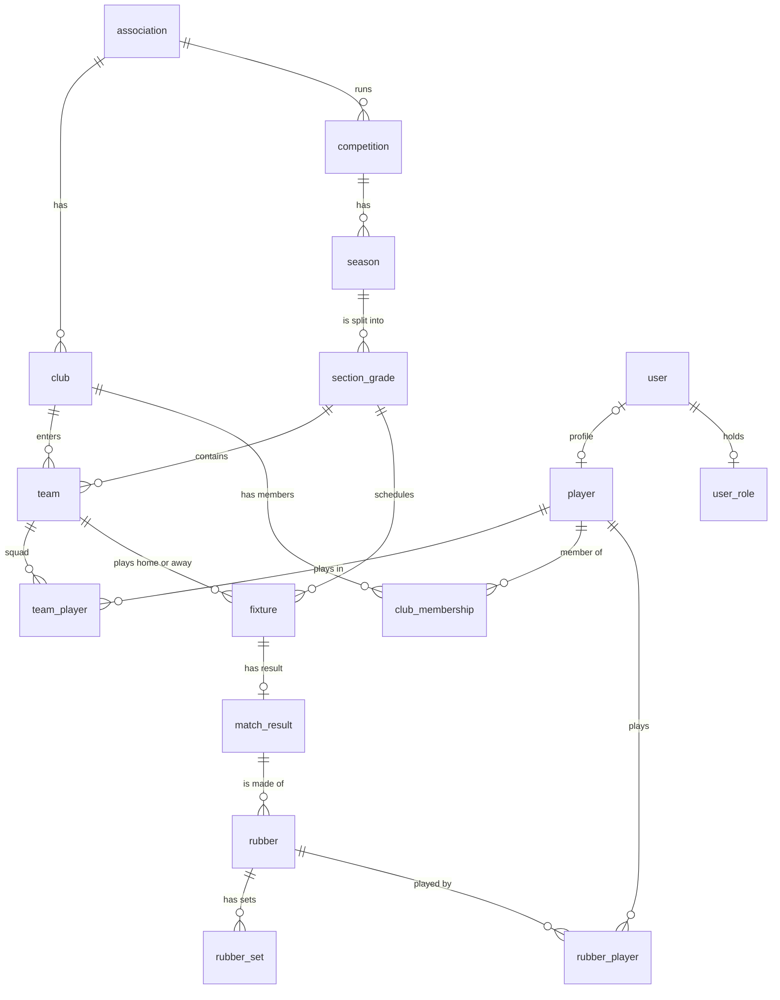
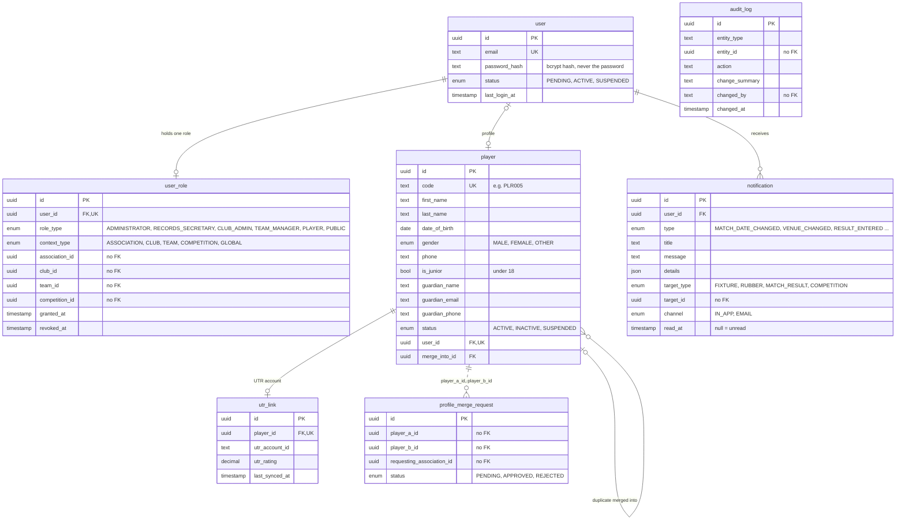
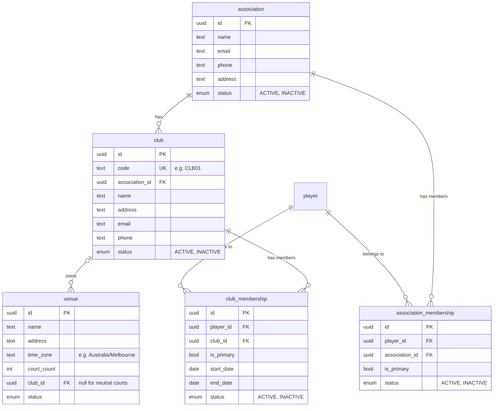
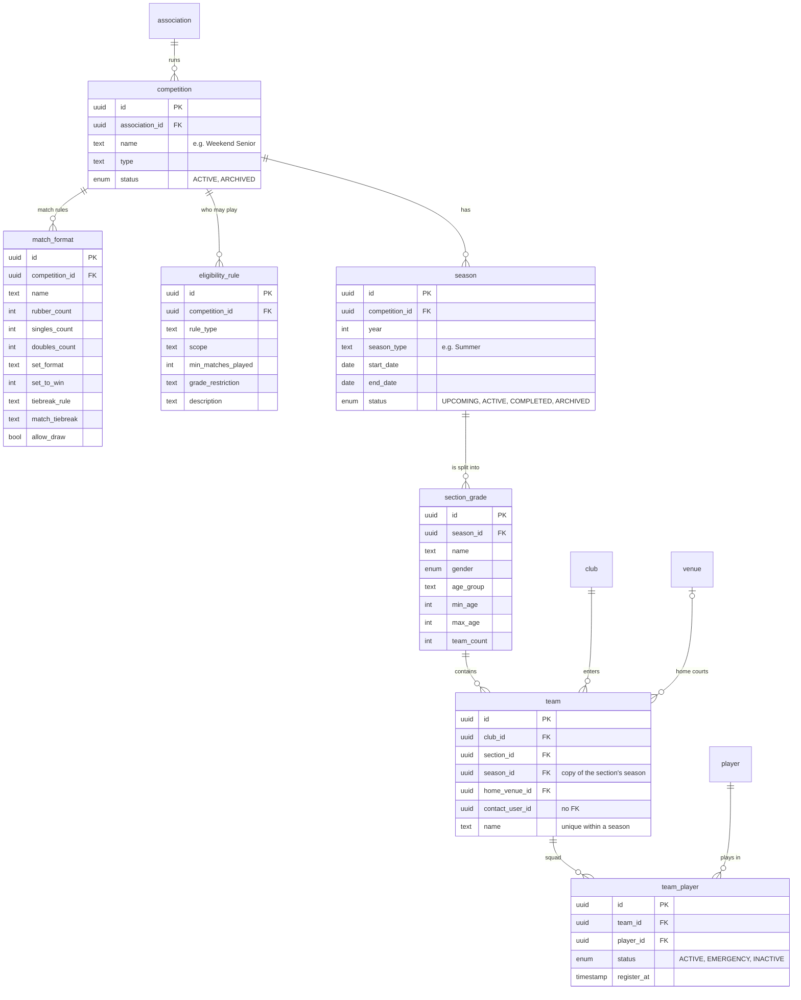
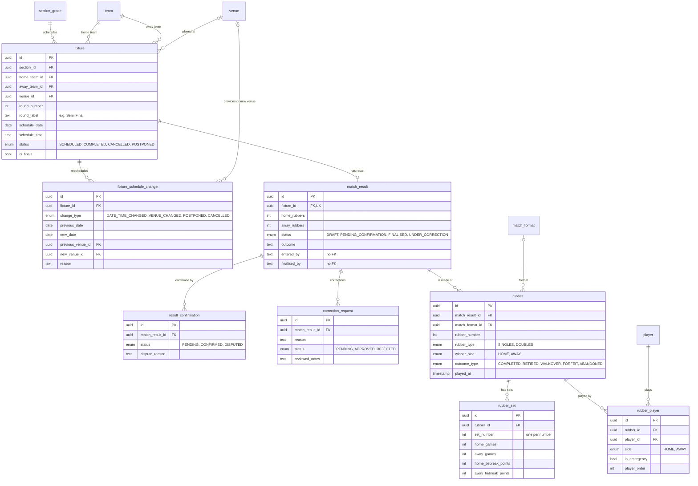
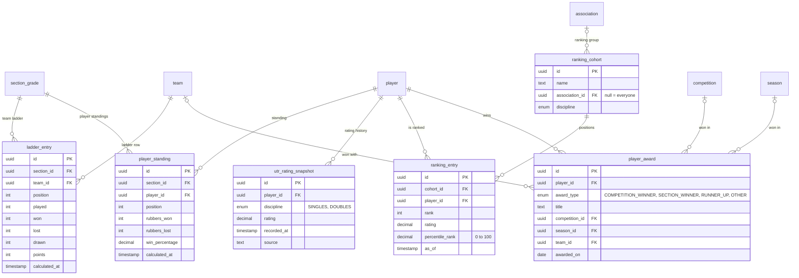

# Database

What the database holds, how its tables connect, and which of its data is test data. For how to
connect to it, see [README → Database access](../README.md#database-access).

- **Engine.** PostgreSQL 16 on your computer (Docker, [docker-compose.yml](../docker-compose.yml)) and
  Azure Database for PostgreSQL Flexible Server on the live site (`tennis-db`).
- **Where it is defined.** [backend/prisma/schema.prisma](../backend/prisma/schema.prisma) describes
  every table. The database is only ever changed through the migrations in
  [backend/prisma/migrations/](../backend/prisma/migrations) (13 so far), and the live site
  applies new ones automatically when it starts.
- **Names.** 33 tables. In the database, tables and columns are snake_case (`club_membership.is_primary`).
  The backend code calls the same things by camelCase names (`ClubMembership.isPrimary`).
- **Keys.** Every table has a UUID `id` primary key. Players and clubs also have a short readable
  code (`PLR005`, `CLB01`), given automatically by a database trigger.
- **Common columns.** Most tables also have `created_at` and `updated_at`; the diagrams leave them out.
- **Data.** Everything in the database today is made-up test data. See
  [Data in the database](#data-in-the-database).

## Reading the diagrams

The diagrams are entity relationship diagrams (ERDs) in crow's foot notation. GitHub draws them
from the text; in VS Code, install a Mermaid preview extension.

| Symbol | Meaning |
| --- | --- |
| `\|\|` | exactly one |
| `o\|` | zero or one |
| `o{` | zero or more |
| solid line | a foreign key: the database refuses a row that points at nothing |
| dashed line | a column that holds another table's ID with no foreign key; the code keeps it right |

For example, `club ||--o{ team` reads "a club has zero or more teams; each team has exactly one club".

## Overview

The main tables and how they connect. The sections below cover every table.

In words: an **association** (Waverley Tennis) has **clubs** and runs **competitions**. Each
competition has **seasons**, each season is split into **sections** (grades), and clubs enter
**teams** into sections. A team's squad is its **team players**. **Fixtures** are matches between
two teams in a section; a fixture's **match result** is made of **rubbers** (single singles or
doubles matches), each with its **sets** and the **players** who played it. A **user** is a login;
most logins have a **player** profile and one **role**.

## 1. Accounts and people

| Table | What one row is |
| --- | --- |
| `user` | A login: email, bcrypt password hash and status. Only `ACTIVE` accounts can log in. |
| `user_role` | The single role a login holds, and where it applies: `CLUB_ADMIN` of a club, `TEAM_MANAGER` of a team, `ADMINISTRATOR` of an association, and so on. Setting `revoked_at` ends it. |
| `player` | A person's profile: name, date of birth, gender, phone and readable code. `is_junior` marks under-18s, who also have a parent or guardian contact. `user_id` links the profile to its login; a player a club adds has no login. |
| `utr_link` | The player's Universal Tennis Rating account and latest rating. |
| `profile_merge_request` | Two profiles that are probably one person registered twice, waiting for a decision. |
| `notification` | One message to one login, in the app or by email, with what it links to and when it was read. |
| `audit_log` | A record of an important change: what changed, who changed it and when. |

## 2. Associations, clubs and venues

| Table | What one row is |
| --- | --- |
| `association` | A tennis association, such as Waverley Tennis, with its contact details. |
| `club` | A club, which belongs to one association. |
| `venue` | Courts where fixtures are played, with their time zone and number of courts. Owned by a club, or by no one (neutral or hired courts). |
| `club_membership` | A player's membership of a club. One per player and club; `is_primary` marks the club that looks after the player's record. |
| `association_membership` | A player's membership of an association. One per player and association. |

## 3. Competitions, seasons and teams

| Table | What one row is |
| --- | --- |
| `competition` | A competition run by an association, such as Weekend Senior or Mid-Week Ladies. |
| `match_format` | The rules for matches in a competition: how many rubbers, singles and doubles, sets and tiebreaks. |
| `eligibility_rule` | A rule about who may play, such as the minimum matches needed to play in finals. |
| `season` | One season of a competition, with its dates and status. |
| `section_grade` | A section (grade or division) of a season, with its gender and age limits. |
| `team` | A club's team in one section. No two teams in a season share a name, ignoring capitals and spaces. |
| `team_player` | One player in a team's squad: a regular, an emergency or no longer active. One per team and player. |

## 4. Fixtures and results

| Table | What one row is |
| --- | --- |
| `fixture` | A match between two teams in a section: round, date, time, venue and status. |
| `fixture_schedule_change` | One reschedule or venue change of a fixture, keeping the old and new values. The club administrator's fixture list marks a fixture as changed when it has one. |
| `match_result` | A fixture's result: rubbers won by each side, and its status from draft to finalised. |
| `result_confirmation` | The other team confirming or disputing a result. |
| `correction_request` | A request to correct a result, and its review. |
| `rubber` | One singles or doubles match within a fixture. Its winner comes from the set scores, except after a retirement, walkover or forfeit, when `winner_side` records it. |
| `rubber_set` | One set of a rubber: games each side, plus tiebreak points for a 7-6 set. |
| `rubber_player` | A player who played a rubber, on which side, and whether as an emergency. |

## 5. Ladders, standings, ratings and awards

| Table | What one row is |
| --- | --- |
| `ladder_entry` | One team's row in its section's ladder: played, won, lost, drawn, rubbers, sets, games and points. One per section and team. |
| `player_standing` | One player's individual record in a section, counted from finalised rubbers. One per section and player. |
| `utr_rating_snapshot` | One dated UTR rating of a player, singles or doubles. The platform stores ratings; it does not calculate them. |
| `ranking_cohort` | A group of players compared with each other, such as one association's singles players. |
| `ranking_entry` | A player's dated rank and percentile within one ranking group. |
| `player_award` | A title or award a player won, alone or with a team. |

## Columns that are not foreign keys

These columns point at other rows, but the database does not check them (the dashed lines above):

- `user_role.association_id`, `club_id`, `team_id` and `competition_id`: where the role applies.
- `profile_merge_request.player_a_id`, `player_b_id` and `requesting_association_id`.
- `notification.target_id`: a fixture, rubber, match result or competition, as `target_type` says.
- `audit_log.entity_id`: the row that changed, in the table `entity_type` names.
- `team.contact_user_id`: not used yet.
- Columns ending in `_by` record who did something. Most hold the person's player ID;
  `match_result.entered_by`, `match_result.finalised_by` and `fixture_schedule_change.changed_by`
  hold their readable code instead (for example `PLR006`). `audit_log.changed_by` holds a club
  administrator's login ID for changes made in the app.

## Data in the database

### Everything is test data

All of it comes from one spreadsheet, [backend/prisma/competition_data.xlsx](../backend/prisma/competition_data.xlsx),
which `backend/prisma/generate-competition-data.js` writes and `npm run seed:competition` loads.
It has one sheet per table, and its `README` sheet explains the rules it follows. The live database
was filled from the same workbook. So both databases hold made-up people and contact details; only
the competition rules and match formats come from a real source, the Waverley Tennis competition
match formats document.

- Every email address uses a reserved `.example` domain (`players.example`, `admin.example`,
  `juniors.example`, `families.example`), so no message can reach a real person.
- Phone numbers, dates of birth, ratings and addresses are made up.
- All 124 logins share the password `WaverleyDev#2026`; the workbook stores only its bcrypt hash.
- Two names, Hiro Mitchell and Amelia Lee, each belong to two different people on purpose, to test
  that look-alikes are never mixed up.
- Ten juniors (under 18) play in Weekend Junior's coming season, each with a parent or guardian on
  record. Who may see their details is in [junior-privacy.md](junior-privacy.md).

| Area | Rows in the workbook |
| --- | --- |
| Accounts and people | `user` 124, `user_role` 124, `player` 124, `utr_link` 100, `profile_merge_request` 1, `notification` 264, `audit_log` 479 |
| Associations, clubs and venues | `association` 2, `club` 12, `venue` 13, `club_membership` 257, `association_membership` 160 |
| Competitions, seasons and teams | `competition` 5, `match_format` 13, `eligibility_rule` 11, `season` 6, `section_grade` 9, `team` 43, `team_player` 250 |
| Fixtures and results | `fixture` 292, `fixture_schedule_change` 7, `match_result` 274, `result_confirmation` 274, `correction_request` 111, `rubber` 822, `rubber_set` 1,685, `rubber_player` 2,192 |
| Ladders, standings, ratings and awards | `ladder_entry` 40, `player_standing` 245, `utr_rating_snapshot` 800, `ranking_cohort` 2, `ranking_entry` 200, `player_award` 36 |
| **Total** | **8,977** |

The 124 logins are 92 players, 18 team managers, 12 club administrators (one per club), one
association administrator and one records secretary. [README → Test accounts](../README.md#test-accounts)
lists the ones to try.

### What the app changes

Only the club administrator pages write to the database: entering a team, choosing its squad and
manager, registering a player, adding a player to the club and marking notifications as read. They
change `team`, `team_player`, `user_role`, `player`, `club_membership` and `notification`, and
every change except marking notifications as read is also recorded in `audit_log`. The only other writer is
`npm run players:duplicates -- --create-requests`, which adds `profile_merge_request` rows. Every
other table is read-only in the app today: fixtures, results, ladders, standings, rankings and
awards come only from the workbook, because no page enters results yet.

So after people have used a database, it can differ from the workbook in those tables.
`npm run seed:competition -- --sync` (in `backend/`) makes it match the workbook again; run it with
`--dry-run` first to see what it would change.

### Personal information

The database can hold these personal details: names, dates of birth, gender, phone numbers, login
emails, password hashes (never passwords), and juniors' parent or guardian names, emails and phone
numbers. Who may see a junior's details is set out in [junior-privacy.md](junior-privacy.md).
Until real authentication exists, the live site must hold test data only
([deployment.md → Security](deployment.md#security)).

### Starting with real data

1. Create an empty database and run `npx prisma migrate deploy` in `backend/`. This makes the
   tables; it adds no data.
2. Load the real associations, clubs, competitions, players and logins. The seed always reads
   `backend/prisma/competition_data.xlsx`, so the simplest way is to put a workbook of real data in
   the same layout there, on the computer that runs the seed only. **Never commit it**: the
   repository is public. Logins can only be created this way today, because the app has no sign-up
   page.
3. Never load the test workbook into a database with real people in it: `--sync` deletes rows the
   workbook does not have.
